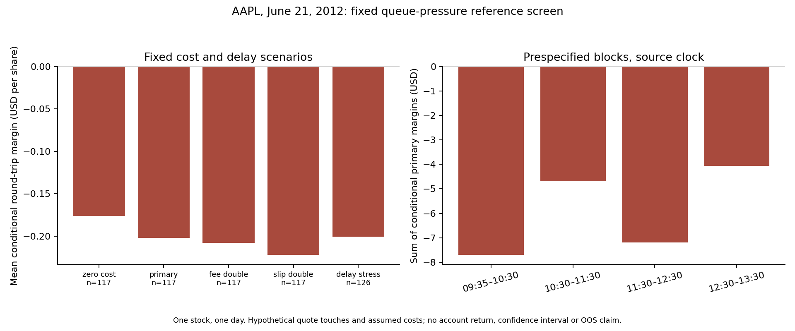

# Queue pressure

A large bid queue can predict an upward price move without offering enough profit to cross the spread. This study tested one fixed version of that idea on AAPL order-book data from June 21, 2012.

It failed. The primary reference completed 117 hypothetical one-share round trips with a combined margin of **-$23.652**, or about **-$0.2022 per trade**, after assumed fees and adverse execution charges. All four prespecified time blocks lost money. Forty exits exceeded the two-second timing requirement. Removing the additional fees and adverse charge still left a negative margin of $20.610.

The pressure rule did slightly better than an exposure-scaled unfiltered control, by about $1.22869 in the primary scenario. That is relative improvement against a losing control, not a profitable strategy.



[Read the report](REPORT.md) for the mechanism, execution convention, controls and failures. [Protocol disclosure](PROTOCOL.md) explains what was fixed before the original evaluation. [Audit notes](AUDIT.md) distinguish the public extraction from the original frozen implementation.

## Reproduce the available checks

Python 3.10 or later is sufficient for the synthetic engine tests and saved aggregate verification. No download, account, API key or raw price file is needed.

```text
python -m unittest test_queue_screen -v
python verify_snapshot.py
```

The first command tests fabricated timing, cost, halt and boundary cases. The second checks the published file hashes and saved aggregate arithmetic. Neither reruns the historical strategy or supplies independent raw replication.

With matplotlib already available, `python plot_results.py` draws the saved results into `regenerated/`. That directory is ignored and is not part of the reviewed snapshot. Figure rendering is not another backtest. See requirements.txt for the plotting dependency.

## Limits

One stock on one day cannot establish a durable edge. Quote touches are hypothetical, receiver clocks and historical fees are unverified, and no funded account or prop-firm payout was modeled. Trades are dependent; there is no p-value, confidence interval or out-of-sample result here. The later session remains economically sealed in the original research project.

The original archive and selected trade ledger are not redistributed. Public sample access does not establish permission to republish its quote rows. Source: [LOBSTER sample documentation](https://php.lobsterdata.com/info/DataSamples.php) and [data structure](https://php.lobsterdata.com/info/DataStructure.php).
